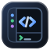

# IDE Workbench

**A JetBrains-style IDE workspace inside the DeepSeek Harness right sidebar.**

Project / Commit / Git / Terminal tool windows surround the plugin's own editor, side by side with the chat — files, code lines, commits and the terminal stay next to the conversation instead of in another window.

This package is **core** (plugin ID stays `dsh-ide-workbench`). Completion, go-to-definition, find usages,
hover and signature help, and the language servers live in the separate plugin
[**dsh-ide-codeintel**](https://github.com/LiangshouX/dsh-ide-workbench/blob/main/packages/codeintel/README_EN.md); install it on top when you want them.

[](https://github.com/LiangshouX/dsh-ide-workbench)

English · [简体中文](https://github.com/LiangshouX/dsh-ide-workbench/blob/main/packages/workbench/README.md)

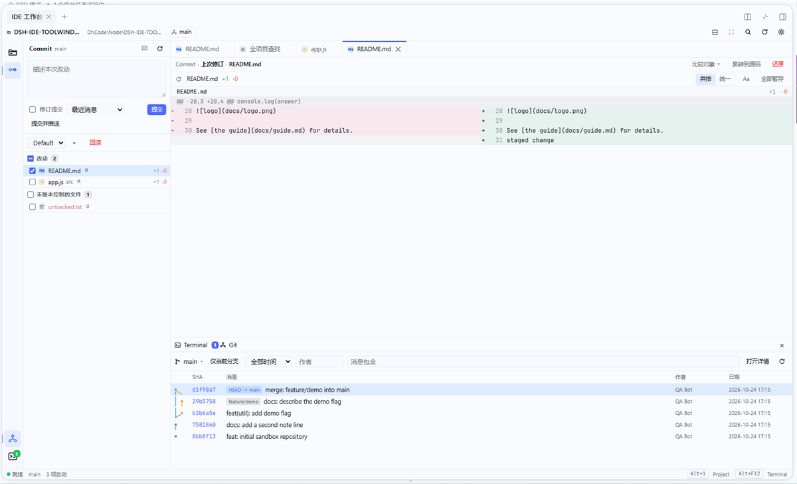

## Why an IDE workbench?

A DSH conversation is a good place to think and change code, but the actual editing still bounces between the chat, a terminal, the file manager and an IDE. IDE Workbench puts a JetBrains-style workspace inside the DSH right sidebar and keeps it **next to the current session**:

- **Same screen as the chat**: file links in the chat open in the workbench and land on their line; from the project tree or the editor, **Send to chat** inserts an `@path` reference into the composer — with the line range and a code block when code is selected.
- **IDEA muscle memory**: `Alt+1` / `Alt+0` / `Alt+9` / `Alt+F12` switch tool windows; single click previews, double click pins; `Alt+Insert` creates, `F2` renames, `Ctrl+K` focuses the commit message, `Ctrl+Shift+K` pushes.
- **Real repositories and a real terminal**: Git goes through the system CLI (credentials, hooks and git config keep working); the terminal is a real PTY; file reads and writes pass a path fence, and saves keep the original encoding and line endings.
- **Follows DSH**: only the host's theme tokens are used, so light/dark and skins follow automatically; native right-sidebar tab, session continuity, settings page; installs on both DSH Desktop and Web profiles.

## Features

| Surface | What it does |
|:--|:--|
| 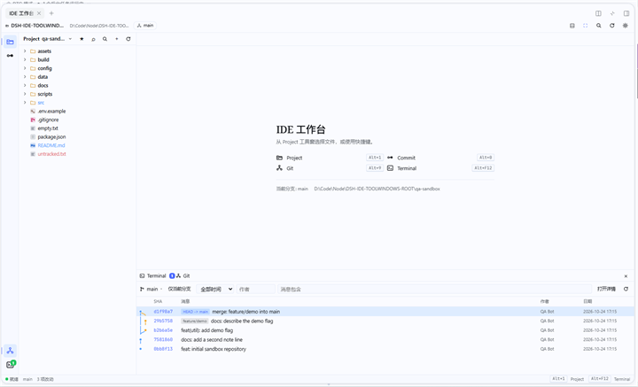 | **Project window.** Lazy file tree with JetBrains status colours (red = untracked, green = added, blue = modified; directories aggregate their children). Single click selects, double click opens or expands; the twisty expands a folder on one click. Ctrl/Shift multi-select, drag to move (Ctrl = copy), create file/folder, `F2` rename, `Delete` (recycle bin first), `F5` copy, `F6` move, `Ctrl+X/C/V`. **Locate file** jumps to the open document; tree filter and project-wide file quick-open; the context menu sends files to the chat. |
| 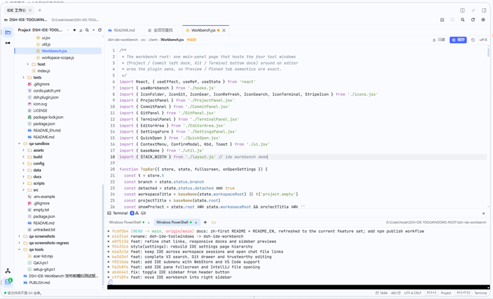 | **Editor.** CodeMirror 6 with syntax highlighting (grammars load on demand) and automatic bracket closing; auto / always editable / always read-only, where auto edits text up to 1 MiB (Markdown opens in the rendered preview by default). `Ctrl+S` saves atomically and keeps UTF-8 / BOM / UTF-16 and CRLF; dirty dots and "unsaved" hints are obvious. An external change raises a **conflict dialog centred on the document**: reload from disk or overwrite it; a file the plugin saved itself never raises a false conflict. In-file find/replace, right-click Git Blame annotation on the line numbers, cursor position and encoding in the status bar. |
| 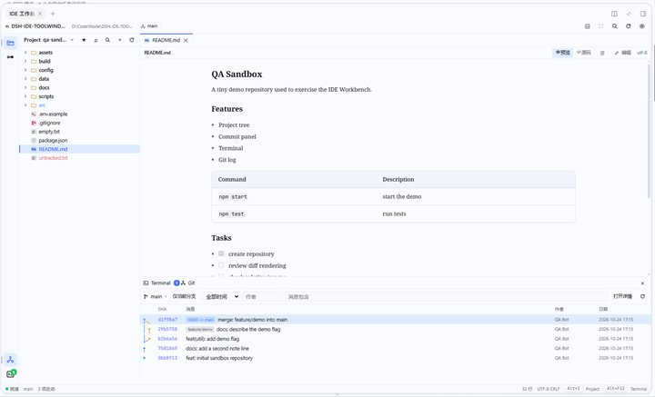 | **Markdown preview.** Rendered with the host's `MarkdownText`, so tables, task lists and code cards match the DSH chat. Opens in the preview by default; "preview / source / edit" switches in one click; the outline jumps and highlights as you scroll. |
| 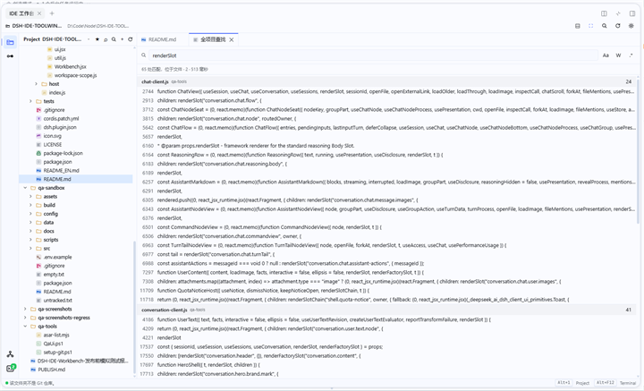 | **Find in Files and quick open.** `Ctrl+Shift+R` opens the **search popup** (`Ctrl+Alt+F` in a plain browser, where the former is the hard-reload shortcut): the file list on top, the hits of the selected file with their context below; double click opens the hit and closes the popup, and no editor tab is taken. A selection seeds the search field. Case / whole word / regex are all there, and the header counts files and matches. `Ctrl+P` / `Ctrl+Shift+N` open files by name. |
| 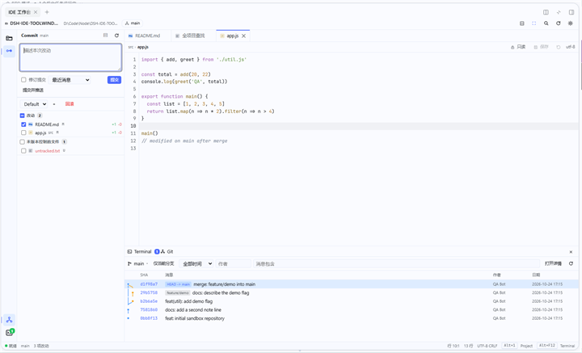 | **Commit window.** `Changes` / `Unversioned` groups; ticking a path includes it in the commit and the list does not jump. Changelists, grouping by directory. Change View (working tree / last revision / latest commit) with jump-to-source and revert; the diff toolbar stages lines and hunks. Commit, commit and push, amend, recent messages, optional pre-commit commands (tests / optimize imports / cleanup). |
| 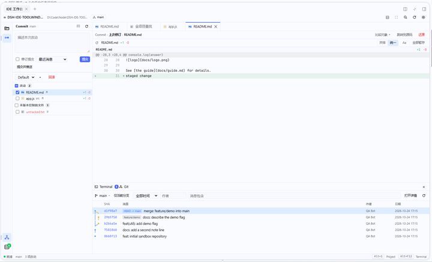 | **Diff.** Side-by-side and unified layouts, word-level highlighting on by default, collapsed unchanged runs. Side-by-side is **two equal panes, each with its own horizontal scrollbar, the two linked**: a very long line pans inside its own half. Compare against the working tree, the last revision, any commit, or two commits (Ctrl+click); stage or discard a single hunk. HTML and binary files open in the DSH sidebar or the system default application. |
| 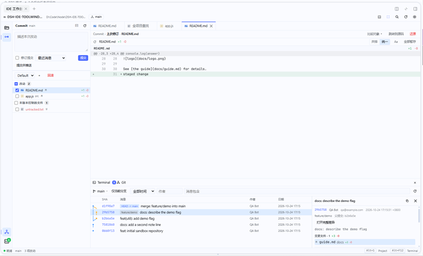 | **Git log.** Paged commit table plus a swim-lane graph; filter by branch / author / message / path. Single click selects, double click (or Enter) opens the detail drawer: metadata, full message, changed files, and a per-file diff on click. Copy the SHA, check out, revert, compare two commits; the project tree can scope the history to a path. |
| 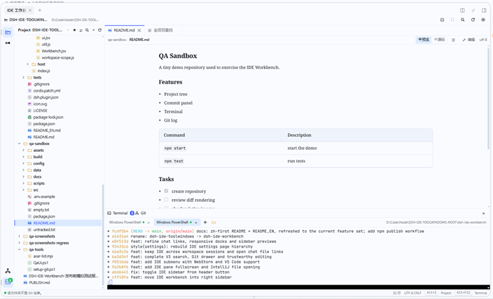 | **Terminal.** Real PTY (WebSocket + xterm.js), several sessions, rename and close; shell profiles (PowerShell / Git Bash / cmd / …). Docked or full screen; after a resize the panel refits and sends the new size to the PTY. Select to copy, `Ctrl+Shift+V` to paste; the working directory follows the project root or the current file. |
| 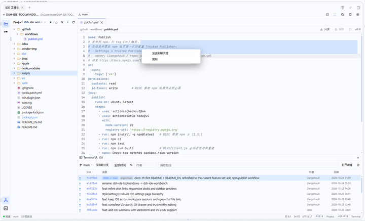 | **Working with the chat.** Chat file links open in the workbench and land on `#L24`; files outside the workspace fall back to the DSH sidebar. The project tree and the editor send files, folders or selected code to the composer: files become `@path` references, code brings its line range and a code block. HTML can be previewed in the DSH sidebar or the system browser; the chat input keeps its focus. |
| 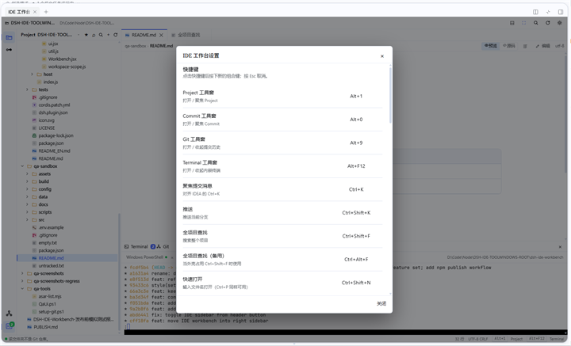 | **Settings and shortcuts.** Tool-window and command shortcuts, which side the entries sit on, default shell, terminal font size, open mode, Markdown preview, hidden/ignored files, chat link behaviour, external IDE paths, git path and commit commands. Changes are written about 300 ms after the last keystroke and confirmed with "saved"; closing the panel never loses the last edit. |
| **Code intelligence (optional)** | Completion, go-to-definition, find usages, hover and signature help come from the separate [**dsh-ide-codeintel**](https://github.com/LiangshouX/dsh-ide-workbench/blob/main/packages/codeintel/README_EN.md) plugin. Core alone has **no completion**; it keeps automatic bracket closing only. With both installed the editor merges the capabilities of the two packages. |

## Install

**Requires** DSH ≥ 0.1.7 (DSH Desktop 0.2.x or a Web profile). Published on npm: [dsh-ide-workbench](https://www.npmjs.com/package/dsh-ide-workbench).

### Option 1: DSH Desktop (recommended)

1. Open **Settings → Plugins**.
2. Choose **Add plugin** and enter `dsh-ide-workbench` (optionally with a version, e.g. `dsh-ide-workbench@0.6.0`); a `.tgz` URL from a Release also works (see option 4).
3. After installing, open the workbench from the session header button (or the persistent entry at the bottom of the sidebar).

> The Desktop profile belongs to the Electron application: `dsh plugin --profile desktop ...` is refused. Use the plugin page there — it installs into the profile the Desktop itself serves.

### Option 2: CLI / npm

```sh
# Install into a profile (e.g. web)
dsh plugin --profile web add dsh-ide-workbench

# Pin a version
dsh plugin --profile web add dsh-ide-workbench@0.6.0
```

Restart that profile afterwards; if the bundle is not enabled yet, turn on **IDE Workbench** in **Settings → Plugins**.

### Option 3: Git repository or a local directory

```sh
# Straight from GitHub (the repository ships the built dist/client.js)
dsh plugin --profile web add git+https://github.com/LiangshouX/dsh-ide-workbench.git

# Or clone and install from the directory
git clone https://github.com/LiangshouX/dsh-ide-workbench.git
dsh plugin --profile web add ./dsh-ide-workbench/packages/workbench
```

### Option 4: Offline packages

Every [Release](https://github.com/LiangshouX/dsh-ide-workbench/releases) ships two kinds of offline package:

| Package | Use it when | How |
|:--|:--|:--|
| `dsh-ide-workbench-<version>.tgz` | the profile can reach the npm registry (or an internal mirror) | `dsh plugin --profile web add ./dsh-ide-workbench-0.6.0.tgz` |
| `dsh-ide-workbench-<version>-offline.zip` | the machine is **fully offline** | unpack it and run `install-offline.ps1` (Windows) or `install-offline.sh` (macOS / Linux); see `README-OFFLINE.md` inside |

The offline zip carries the runtime `node_modules` and an install script: the script copies the plugin into
`<profile>/offline-plugins/`, registers it in the profile's `package.json` (dependency + bundle list), and
needs neither network access nor pnpm. Restart DSH afterwards.

## After installing

- Three entries: the session header button, the new-session row and the sidebar's bottom action.
- The workbench is a native right-sidebar tab, so it sits next to the chat; `F11` toggles full screen.
- The first open selects the current DSH workspace; the project header switches the IDE project root (workspace root or a first-level subdirectory).

## Quick start

1. **Open the workbench**: click the IDE icon in the session header, or press `Alt+1` to focus Project.
2. **Pick a project**: choose the workspace root or a first-level subdirectory (ones with `.git` carry a badge).
3. **Work**: double click a file; `Ctrl+Shift+R` searches, `Alt+0` commits, `Alt+F12` opens the terminal, `Ctrl+K` writes the commit message.

### Shortcuts

| Action | Keys |
|:--|:--|
| Switch tool window | `Alt+1` Project · `Alt+0` Commit · `Alt+9` Git · `Alt+F12` Terminal |
| Focus commit message / push | `Ctrl+K` / `Ctrl+Shift+K` |
| Find in Files / fallback | `Ctrl+Shift+R` / `Ctrl+Alt+F` |
| Quick open a file | `Ctrl+P` or `Ctrl+Shift+N` |
| Full screen / dock | `F11` |
| Hide every tool window | `Ctrl+Shift+F12` |
| In-file find | `Ctrl+F`, `F3` |
| Save / close tab | `Ctrl+S` / `Ctrl+W` |
| File operations | `Alt+Insert` new · `F2` rename · `F5` copy · `F6` move · `Delete` · `Ctrl+Alt+Shift+C` copy path |
| Commit detail | `Ctrl+Alt+D` |

> Tool-window, commit, push, find and quick-open shortcuts can be rebound in **Settings → IDE Workbench**; `F2` / `F5` / `F6` / `Delete`, `Ctrl+Alt+D` and `Ctrl+Shift+F12` keep their defaults (editable in the settings document).
> Completion, go-to-definition and find-usages shortcuts belong to [codeintel](https://github.com/LiangshouX/dsh-ide-workbench/blob/main/packages/codeintel/README_EN.md).

## Workspace vs IDE project root

A DSH workspace is often a container: the root is not a git repository, while its first-level subdirectories are. The project header lets you pick the **workspace root** or any first-level subdirectory; the choice is stored per workspace (`projectRoots`), and switching it moves the Project tree, Git/Commit data, the cwd of new terminal sessions and the restored tabs together. When the directory is not a repository, all four windows offer the "pick a git subproject" guidance.

## Code intelligence (separate plugin)

This package is the **workbench**: four windows, the editor, file operations, Git and the terminal. Completion,
go-to-definition, find usages, hover and signature help, the language servers and the memory budget live in
[**dsh-ide-codeintel**](https://github.com/LiangshouX/dsh-ide-workbench/blob/main/packages/codeintel/README_EN.md):

```sh
dsh plugin --profile web add dsh-ide-codeintel
```

The two packages cooperate through a versioned contract: one CodeMirror runtime, one editor seam, four client slots.
Load order does not matter, and with both installed the same capability is served by the higher-priority package
(automatic bracket closing, for instance, moves to codeintel). Core alone has no completion and no language server
in the process tree.

## DSH integration

- **Entries**: the session header button, the new-session row and the persistent bottom action all open the panel through the native `sidebar.right.pane.tab`, next to the chat; the bottom entry stays reachable when a skin hides the header tools.
- **Session continuity**: conversations of one DSH workspace share one workbench state — the file tree, open tabs and Git context survive switching (and creating) sessions; when the workbench was visible in the conversation being left, it reopens in the new one. Switching conversations keeps the terminal; switching sessions rebuilds the PTY and the editor undo history.
- **Chat file links**: user `@` references and assistant Markdown links open in the workbench, expand the tree and land on the `#L24` line; files outside the workspace fall back to the DSH sidebar; files inside the workspace but outside the IDE project ask before widening it to the workspace root. Settings → IDE Workbench → chat file links can switch back to always using the DSH sidebar.
- **Send to chat**: from the project tree or the editor, send files, folders or selected code lines to the composer. Paths become `@path` references; code lines carry `(Lstart-Lend)` and a code block.
- **Preview fallback**: right click a file or tab to open it in a DSH sidebar tab, rendered by the host; HTML files get two floating actions ("preview in the DSH sidebar", "open in the default browser").
- **Theme**: only `--dsw-alias-*` tokens, so light/dark and skins follow the host exactly.

## Security and data

- Git runs through the system CLI (argv arrays, never shell strings), so credential helpers, hooks and git config keep working; paths come from `status --porcelain=v2 -z`, `diff --numstat -z` and the `log` stream.
- File access passes a path fence (403 outside the root), and saves are atomic with the original encoding and line endings preserved.
- Every HTTP / WebSocket route goes through the same Connection admission fence as `/api`.
- Settings live in the profile directory at `ide-workbench/settings.json` (DSH Desktop: `~/.dsh/profiles/<profile>/ide-workbench/settings.json`): shortcuts, which side the tool windows sit on, shell, git paths, open mode, UI geometry, expanded folders and open tabs per workspace.

## Known limitations

- The project picker only scans first-level subdirectories; it does not discover repositories recursively.
- DSH restarts do not restore terminal sessions (the PTY dies with the process).
- The host sidebar icon has no numeric badge (the plugin draws its own stripe badge).
- The Markdown preview does not rewrite relative images / links to local paths (http(s) works).
- Not done: interactive rebase, three-way merge editing, stash, fetch/pull, split terminals.
- `Ctrl+Shift+R` is Chromium's **hard reload** in the plain browser form (DSH Web); the page cannot intercept it, so it reloads the whole page and loses unsaved buffers. **Use `Ctrl+Alt+F` in the browser**; DSH Desktop is unaffected.
- **Send to chat** relies on the chat composer action the host publishes to the session slot; when it is missing the plugin says so instead of dropping the input. Code references are `@file (Lx-Ly)` plus a code block (`@` syntax has no line suffix of its own).
- The editor context menu only takes over the system menu when something is selected (offering "send to chat / copy"); an empty selection keeps the native menu.

## Development

From the repository root (monorepo):

```sh
npm install
npm run build:core   # bundle this package's src/client into dist/client.js (React external, xterm inlined)
npm test             # host git/diff/graph + component SSR + client regression tests
```

Source layout:

```
src/index.js                host half: fenced HTTP API + terminal WebSocket
src/host/git.js             git CLI adapter: status/log/numstat/blame parsing
src/host/workspace.js       path fence, directory tree, file preview, shell
src/host/fileops.js         create/rename/copy/move/delete (recycle bin)
src/host/settings-store.js  JSON settings persistence
src/client/index.jsx        client entry: sidebar tab, shortcuts, chat input bridge
src/client/store.js         workbench state machine (project, tabs, search, Git, settings)
src/client/SearchPopup.jsx  Find in Files popup
src/client/blame-gutter.js  the Git Blame column left of the line numbers
src/client/*.jsx            tool windows and editor UI
src/client/chat-bridge.js   send to chat: @ references and code blocks
```

Rebuild `dist/client.js` and run `npm test` before committing.

The screenshots and the badge strip of this README live in `docs/readme/` and are referenced through `main` branch raw URLs — neither DSH nor npm resolves relative image paths, and raw URLs work on GitHub, IDEA and Typora alike.

## Feedback and license

- Issues / ideas: [GitHub Issues](https://github.com/LiangshouX/dsh-ide-workbench/issues)
- Releases: [GitHub Releases](https://github.com/LiangshouX/dsh-ide-workbench/releases) · [npm versions](https://www.npmjs.com/package/dsh-ide-workbench?activeTab=versions)
- License: MIT. xterm.js and ws keep their own MIT licenses.

> Screenshots from DSH Desktop 0.2.1 (Windows 11, light theme); the UI language follows the DSH settings. The sample project is a throwaway Git sandbox.
